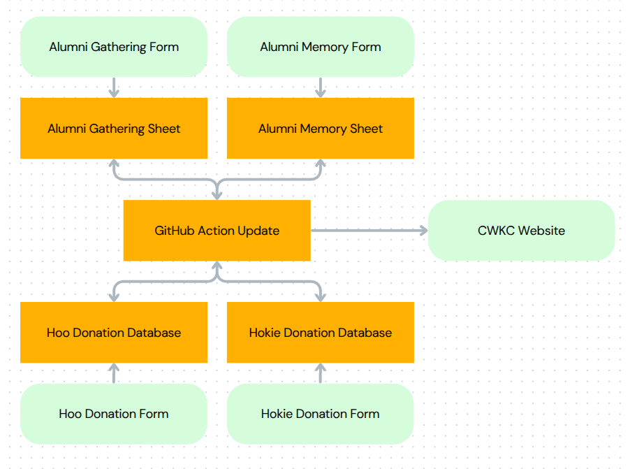

# Commonwealth Kiddush Cup (CWKC)

A two-Hillel fundraising competition site: donations are handled by each school's **Little Green Light** (LGL) forms, participation comes from Google Forms, and Python calculates scores for a static GitHub Pages website.

**Public site:** https://cwkc.org

## Where to start

| I want to… | Read |
| --- | --- |
| Understand or run the app locally | [Development](docs/development.md) |
| Connect LGL donation or Google participation forms | [Forms](docs/forms.md) |
| Configure, deploy, monitor or recover a live event | [Operations](docs/operations.md) |
| Check **this year's** go/no-go decisions | [2026 launch checklist](docs/2026-launch-runbook.md) · [issue #41](https://github.com/msaperst/cwkc-v2/issues/41) |
| Adapt the code for different Hillels | [Adapting CWKC](docs/adapting.md) |

## How it works

1. **Collect:** Schools own their payment forms. LGL sends notification emails to a dedicated mailbox; Google Forms write participation to linked Sheets.
2. **Normalize:** Python importers validate and deduplicate as appropriate, storing donation rows in a **private**, season-specific Google Sheet. Ambiguous submissions fail closed.
3. **Calculate:** Donation and participation metrics become `public/assets/csv/results.csv`, which the static HTML/JavaScript site displays.
4. **Publish:** GitHub Actions refreshes results during the event window on `cwkc-results`; `main` holds reviewed code and a safe starter CSV. A watchdog flags stale/failed ingestion.

The default setup uses scheduled GitHub Actions: **no personal computer or always-on local poller** is required. Donor source records and actual donation reconciliation remain the Hillels' responsibility.

## Local quick start

Use Git, Python **3.12**, Node.js **24**, and npm:

~~~bash
git clone https://github.com/msaperst/cwkc-v2.git
cd cwkc-v2
npm ci
python3.12 -m venv .venv
source .venv/bin/activate
python -m pip install -r scraper/requirements-test.txt
python -m http.server 8000 --directory public
~~~

Open http://localhost:8000. No private credentials are necessary to preview the site (the timer may hide scores outside event dates). Test with synthetic data:

~~~bash
npm test
python -m pytest scraper/tests --maxfail=1 -q
npx playwright install chromium
npm run test:browser
~~~

See [Development](docs/development.md) for component paths, score/schema changes and more detailed testing.

**Safety:** Do not commit real donor data, full LGL notifications, credentials, or **staff/backend LGL URLs**. Live import scripts can modify Google Sheets and IMAP Seen flags even when the GitHub Actions ingestion switch is disabled. Run isolated tests and authorized read-only preflights first.
