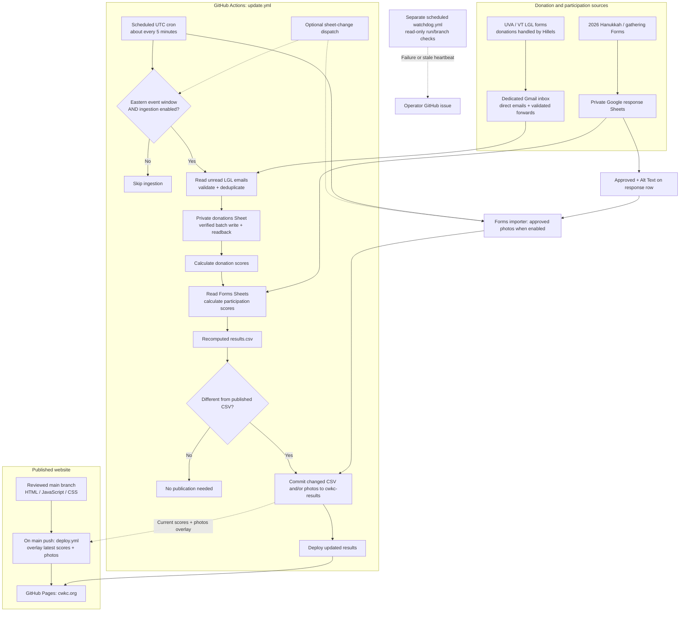

# Commonwealth Kiddush Cup (CWKC)

[CWKC](https://cwkc.org) is a static UVA–Virginia Tech fundraising competition website. Schools receive donations through their own **Little Green Light (LGL)** forms; Google Forms collects participation; GitHub Actions calculates and publishes the scoreboard. This repository **does not process payments**.

## How it works

1. LGL sends donation notifications (including approved staff forwards) to a dedicated Gmail inbox.
2. The scheduled Python importer parses unread notifications, deduplicates by LGL Submission ID, and writes verified rows to the **private** season-specific donations Google Sheet.
3. A second importer counts Hanukkah and alumni-gathering participation from linked Google Forms response Sheets.
4. The calculator produces `public/assets/csv/results.csv`. GitHub Actions stores the published snapshot on `cwkc-results` and deploys the static site through GitHub Pages.
5. The same Forms importer prepares explicitly approved, optimized images. The updater publishes scores and photos to the same data branch.
6. A separate watchdog checks that ingestion continues during the event.

### Current production workflow

The email inbox and Forms response Sheets are **data sources, not triggers**. GitHub's schedule drives normal updates; an optional Forms `sheet-change` dispatch can request an earlier run. Both paths execute the **same** fully gated recomputation. The same update also synchronizes photos when enabled, independently of the score gate.

**Important boundaries:** The update workflow skips processing outside the configured Eastern-time competition window or while `CWKC_INGESTION_ENABLED` is not `true`. Unread notifications are only acknowledged after the private ledger write is verified. A source error blocks score publication; a changed CSV is committed to `cwkc-results` rather than to protected `main`. The watchdog observes workflow health but does not read private donations. Photo publication is separately enabled with `CWKC_PHOTOS_ENABLED` and is not date-gated; see [photo moderation](docs/photos.md).

`main` is reviewed code and a **zeroed starter CSV**; `cwkc-results` holds the last published scoreboard and approved gallery. The default ingestion is GitHub's **scheduled five-minute update**—no external email poller or always-on machine is required.

**2026 event:** November 30, 00:00 EST – December 7, 20:00 EST. The single season config is `public/assets/config/season.json`, using `America/New_York`. GitHub schedules are expressed in UTC, and the Python gate enforces the actual configured instants.

## Documentation

- **[Deploy your own CWKC](docs/deploy-your-own.md): complete fork-to-launch guide** for another Hillel pair, including LGL, Gmail, Sheets, Forms, GitHub Actions, Pages, customization and optional form-submit dispatch.
- [Development](docs/development.md): run locally, test, make code changes.
- [Forms and scoring](docs/forms.md): LGL schemas, normalization, participation rules and source access.
- [Photo moderation](docs/photos.md): upload access, approval notifications, publication and takedown.
- [Operations](docs/operations.md): credentials, scheduled ingestion, deployment, recovery and launch/cutoff.
- [GitHub issues](https://github.com/msaperst/cwkc-v2/issues): launch tasks, photo viewer, improvements and other future work. [2026 launch tracker #41](https://github.com/msaperst/cwkc-v2/issues/41).

## Quick start (no live credentials)

Requires Python 3.12 and Node.js 24:

~~~bash
npm ci
python3.12 -m venv .venv
source .venv/bin/activate
python -m pip install -r scraper/requirements-test.txt
python -m http.server 8000 --directory public
~~~

Browse http://localhost:8000. Run the test suites:

~~~bash
npm test
python -m pytest scraper/tests -q
npx playwright install chromium
npm run test:browser
~~~

**Privacy:** Never commit real LGL emails, donor records, credentials, raw photo uploads or staff/backend LGL form URLs. Source-of-truth payments must be reconciled privately with LGL. Running a live importer outside GitHub Actions can modify Sheets and Gmail flags even when the workflow's kill switch is off.
