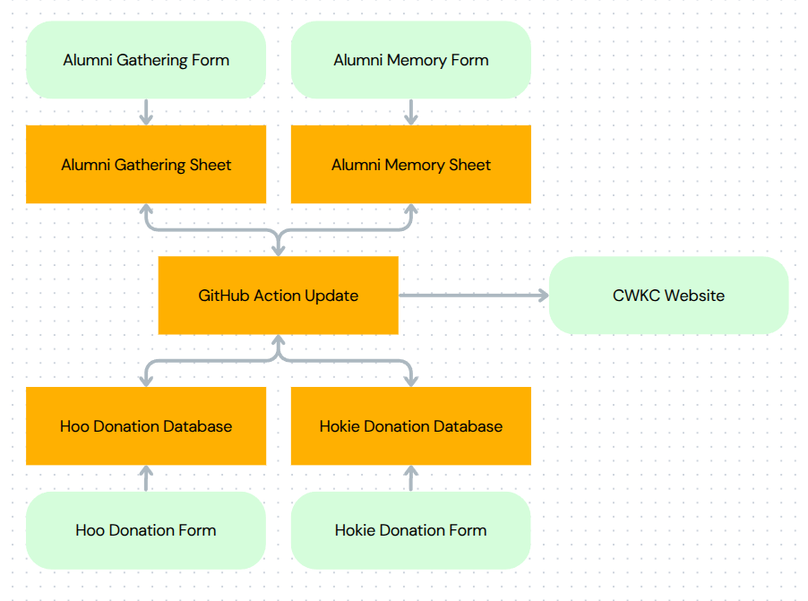

# Commonwealth Kiddush Cup (CWKC)

The Commonwealth Kiddush Cup is an annual fundraising competition between UVA and Virginia Tech. This repository contains the public scoreboard and the scripts that turn donation and participation submissions into scores. Donations are collected by the Hillels' forms, not by this website.

**Website:** https://cwkc.org · **Hosting:** GitHub Pages · **Repository:** https://github.com/msaperst/cwkc-v2

## How it works

[Edit the architecture diagram in Canva](https://www.canva.com/design/DAGgbkbv3WQ/oSKlD4TjEMOe_xGGQLPTSQ/edit)

There are two data sources:

- **LGL donations:** Little Green Light (LGL) form submissions send notification emails to `servicecwkc@gmail.com`. `scraper/pollEmail.py` looks for unread messages and sends a GitHub `lgl-form-submission` dispatch. `scraper/getLglFormData.py` parses the emails, writes normalized donations to Google Sheets, and calculates scoreboard metrics.
- **Participation forms:** Google Forms store gathering/photo responses in linked Google Sheets. An Apps Script trigger sends a GitHub `sheet-change` dispatch. `scraper/getGoogleFormData.py` reads the sheets and updates the participation metrics.

The resulting scoreboard is stored in `public/assets/csv/results.csv`. The static site (`public/index.html` plus `public/assets/js/main.js`) reads that CSV and awards points according to the HTML `data-points` attributes. GitHub Actions handles data updates and deployment.

## Project layout

| Path | Purpose |
| --- | --- |
| `public/index.html` | Website content, links, scoring categories and layout |
| `public/assets/js/main.js` | CSV rendering, points, countdown and results refresh |
| `public/assets/csv/results.csv` | Generated scoreboard data consumed by the browser |
| `scraper/EmailParser.py` | Normalize LGL email fields |
| `scraper/CalculateValues.py` | Calculate donation metrics |
| `scraper/getLglFormData.py` | Process unread LGL emails and update donation results |
| `scraper/getGoogleFormData.py` | Read gathering/photo response sheets |
| `scraper/pollEmail.py` | Poll mailbox and trigger GitHub data updates |
| `scraper/tests/` and `public/assets/js/*.test.js` | Python and JavaScript tests |
| `.github/workflows/test.yml` | PR test/coverage/SonarCloud checks |
| `.github/workflows/update.yml` | Google Sheet/LGL ingestion and results publishing |
| `.github/workflows/deploy.yml` | Static website deployment to GitHub Pages |

## Local development

**Requirements:** Git, Node.js 24 with npm, and Python 3.12.

~~~bash
git clone https://github.com/msaperst/cwkc-v2.git
cd cwkc-v2

npm ci

python3.12 -m venv .venv
source .venv/bin/activate
python -m pip install -r scraper/requirements-test.txt
~~~

On Windows, activate the virtual environment using the appropriate `.venv/Scripts/activate` script instead.

### Run the website

No donation mailbox or Google credentials are needed to work on the **frontend**.

~~~bash
python -m http.server 8000 --directory public
~~~

Open http://localhost:8000. The site uses CDN-delivered frontend libraries; there is no frontend build step. Edits to files in `public/` are reflected after refreshing the browser.

The real countdown uses fixed competition dates. Outside the active period, the live scoreboard may not load its CSV; test score rendering and timer boundaries with Jest rather than changing production dates just for a local preview. For manual layout work, use local, non-sensitive sample data.

### Run tests

Run both suites from the **repository root**:

~~~bash
npm test
python -m pytest scraper/tests --maxfail=1 -q
~~~

### Browser tests (Playwright)

The browser suite runs the actual site on a **local Python HTTP server**, using headless Chromium in desktop and mobile viewports. Synthetic CSV responses are intercepted in the browser. It does not access Gmail, Google Sheets, live donation forms, or production results, and it does not rely on finalized 2026 scoring categories.

Install the pinned browser once after `npm ci`:

~~~bash
npx playwright install chromium
npm run test:browser
~~~

Playwright starts the local web server automatically; no separate terminal is required. For debugging use `npx playwright test --headed` or `npx playwright show-report` after a failure. CI runs on Ubuntu 24.04, installs the SHA-locked Playwright packages without lifecycle scripts, fetches the pinned Chromium binary, and uploads screenshots/traces only on failure. A browser check is also required before SonarCloud runs. Browser tests are intentionally separate from Jest's unit/coverage suite.

For Python coverage locally:

~~~bash
python -m pytest scraper/tests --cov=scraper --cov-report=term-missing --cov-report=html
~~~

The GitHub Actions test workflow also collects JavaScript coverage and runs SonarCloud. CI installs from `scraper/requirements-ci.lock` using exact versions and SHA-256 wheel hashes for **Python 3.12 on Linux x86_64**. This lock is platform-specific: regenerate and verify wheel hashes when changing dependencies, Python, or the CI platform. For ordinary development use `scraper/requirements-test.txt`.

Work on a feature branch, add or update tests with behavior changes, and open a pull request against `main`. Do not push directly to `main`.

## Credentials and configuration

Live integration scripts access Gmail and Google Sheets. **Do not use production accounts or real donor data for automated tests or local experiments.**

### Mailbox settings

Create `scraper/.env` (ignored by Git) when configuring the email poller or LGL ingestion:

~~~dotenv
EMAIL_ACCOUNT=servicecwkc@gmail.com
EMAIL_APP_PASSWORD=replace-with-Gmail-app-password
SPREADSHEET_KEY=replace-with-normalized-donations-spreadsheet-id
GITHUB_TOKEN=replace-with-GitHub-dispatch-token
~~~

Other supported options include `IMAP_SERVER` (default `imap.gmail.com`), `MAILBOX` (default `INBOX`), `FROM_FILTER`, `SPREADSHEET_SHEET` (default `entries`), `GITHUB_REPO`, and `IDLE_TIMEOUT_SECONDS`. For production GitHub Actions, set the repository **variable** `CWKC_DONATIONS_WORKSHEET` to select the new season's tab for both importer and calculator; do not update a workbook ID or secrets merely to switch tabs. Check the corresponding Python script for the variables it actually uses; the poller needs `GITHUB_TOKEN`, while the LGL processor needs `SPREADSHEET_KEY`.

Use `servicecwkc@gmail.com` for LGL submission notifications. The **Google Cloud service account** used by `gspread` is a separate identity: its `client_email` must have access to the Google Sheets being read or written.

### Google Sheets credentials

Follow the [gspread service-account setup guide](https://docs.gspread.org/en/latest/oauth2.html#for-bots-using-service-account/) to create a credentials JSON file. Keep its private key outside Git.

The current scripts use **working-directory-relative paths**:

- For `getGoogleFormData.py`, run from `scraper/` and place the private credentials file at `scraper/spreadsheet_credentials.json`.
- For `python -m scraper.getLglFormData`, run from the repository root and provide `spreadsheet_credentials.json` in the repository root. This root-level credentials file is also gitignored.

Share the response Sheets with the service account's `client_email`. For editing a Google Form, its associated Sheet and Apps Script, grant the CWKC Google user (`servicecwkc@gmail.com`) **Editor** access to the Form **and** its linked response Sheet. Form-editor access alone is not the same as API access for the service account.

The `update.yml` workflow reconstructs the credentials JSON from GitHub Actions secrets and reads the mailbox and destination-sheet secrets. Refer to that workflow for the expected secret names (including `EMAIL_ACCOUNT`, `EMAIL_APP_PASSWORD` and `SPREADSHEET_KEY`); the test workflow separately uses `SONAR_TOKEN`. Set secrets in the repository's GitHub Actions settings, never in source files.

## Connecting a new or replacement form

### LGL donation forms

1. Configure each Hillel's public and backend LGL form to email **every submission** to `servicecwkc@gmail.com`.
2. Compare the exact notification field labels and form titles against `scraper/EmailParser.py` and its tests. The parser depends on those fields to identify the school, donation type and values.
3. Confirm the destination normalized-donations spreadsheet, its ID (`SPREADSHEET_KEY`), and the service account's Sheet access.
4. Validate with authorized, non-financial test messages and sanitized test fixtures before accepting real donations. Freeze field names/options once verified.

### Google Forms and linked response Sheets

1. Have the owner share both the Form and its linked response Sheet with `servicecwkc@gmail.com` as **Editor**. Share the Sheet with the GCP service account for API access too.
2. Update the spreadsheet IDs and expected response columns in `scraper/getGoogleFormData.py`, with tests for the actual response schema. A new Form or reordered questions can change column positions.
3. In the **linked response Sheet**, open **Extensions → Apps Script**. Create a script like this:

~~~javascript
function triggerGithubAction() {
  const token = PropertiesService.getScriptProperties().getProperty('GITHUB_TOKEN');
  if (!token) throw new Error('GITHUB_TOKEN script property is missing');

  const response = UrlFetchApp.fetch(
    'https://api.github.com/repos/msaperst/cwkc-v2/dispatches',
    {
      method: 'post',
      contentType: 'application/json',
      headers: {
        Authorization: 'Bearer ' + token,
        Accept: 'application/vnd.github+json'
      },
      payload: JSON.stringify({
        event_type: 'sheet-change',
        client_payload: { message: 'Participation response sheet updated' }
      }),
      muteHttpExceptions: true
    }
  );

  if (response.getResponseCode() !== 204) {
    throw new Error('GitHub dispatch failed: HTTP ' + response.getResponseCode());
  }
}
~~~

4. Under **Apps Script → Project Settings → Script properties**, set `GITHUB_TOKEN` to a GitHub token authorized to create repository dispatches. Create an installable **On form submit** trigger for `triggerGithubAction`, authorizing it with the CWKC account. Add an **On change** trigger only if manual Sheet changes also need to trigger updates; avoid duplicate triggers.
5. Verify the trigger with a safe test response and check the resulting GitHub Actions run, parsed totals and CSV contents. Remove test data before production use.

Installable triggers run as the account that created them; keep their ownership under the shared CWKC account, not a departing volunteer's personal account.

## Running integrations

**These commands can change Google Sheets, mark emails as read, publish results, or trigger production Actions. They are not smoke tests.** Confirm credentials, inputs, the approved event window and backup/recovery procedure before using them.

**LGL poller:** from the repository root (with `scraper/.env` configured):

~~~bash
python scraper/pollEmail.py
~~~

The poller looks for unread LGL messages and sends a `lgl-form-submission` dispatch. It does **not** parse or acknowledge donations itself. Leave it running only while collection is authorized, and monitor its output and the corresponding workflow runs.

**Read participation Sheets and update the local CSV:**

~~~bash
cd scraper
python getGoogleFormData.py
cd ..
~~~

**Process unread donation mail into the normalized Sheet and local CSV:**

~~~bash
python -m scraper.getLglFormData
~~~

That last command processes actual unread messages and marks successfully handled ones as read; use it only when production processing is intended, or with a fully isolated test mailbox and spreadsheet.

### Safe backlog reconciliation and restart

The LGL importer stores a SHA-256 fingerprint of each received MIME message in a private `submission id` column of the normalized donations Sheet. The ID and donation fields are written together. On replay, a stored ID prevents a duplicate donation. An email is marked read only after that row has been verified as stored.

To check the unread backlog **without processing, marking emails read, or writing Google Sheets/CSV**, use a properly configured isolated environment, or coordinate a read-only production check with the authorized operator:

~~~bash
python -m scraper.getLglFormData --reconcile-only
~~~

The output contains aggregate counts of `pending`, `already_stored`, and `failed` unread notifications, plus **identified/legacy row counts and whether submission-ID tracking exists**. The preflight reads the normalized Sheet **even when there are zero unread emails**, so an empty mailbox is not mistaken for a migrated Sheet. Donor names and amounts are not printed. No IMAP Seen flags, Sheet cells or CSV are changed. This is a point-in-time check, not proof that the Hillels' totals reconcile; compare it against the authorized LGL reports separately.

A regular update also checks the normalized Sheet when no unread mail is present. **Legacy rows or an inaccessible Sheet block CSV publication even on an empty-inbox run**; do not delete records or change the spreadsheet to force the command to succeed. Perform the privately reviewed season archive/reconciliation first.

**One-time migration:** an older normalized Sheet may contain rows without IDs. The importer deliberately **refuses live writes** when any unkeyed rows exist: some might represent donations whose emails were never acknowledged, and blindly replaying those emails would count them twice. Before kickoff, make a **private** backup/export, reconcile the old rows against LGL and pending notifications, and agree on an archive/verified reset or explicit backfill. Do not erase live rows, fabricate identifiers, or mark messages read just to get past the safety check.

**Restart or failure:** leave failed emails unread, inspect the Actions job failure and the last successful normalized-Sheet state, run the read-only check, then retry only after correcting the cause. A successful Sheet append followed by a failed IMAP acknowledgment will be recognized by its stored ID during the next run. Any processing failures produce a nonzero exit code so the update workflow cannot publish an incomplete CSV. An LGL duplicate *notification with a different MIME identity* still needs upstream LGL reconciliation; the fingerprint guarantees idempotent **email replay**, not deduplication of distinct form submissions.

## Scheduled operation, protected main and cutover

The preferred event-week operating mode is **GitHub Actions polling, not a computer left running**. `.github/workflows/update.yml` schedules UTC runs at minutes :02, :07, ..., :57 on Nov 30 and Dec 1–8, plus one best-effort :59 tick at 00:59 UTC on Dec 8 (Dec 7 at 7:59 PM Eastern in 2026). A scheduled run recalculates *both* Google participation and unread LGL notifications, so the separate local IMAP poller is **not needed** in this mode. If both are active, their triggers can cause redundant work; keep `scraper/pollEmail.py` stopped unless using an explicitly coordinated fallback.

**Important limitations:** GitHub's schedule is best-effort, may be delayed/dropped, and is automatically disabled after 60 days of inactivity on a public repository. Check the workflow is enabled before the event, monitor successful runs and email backlog, and plan for manual recovery. Cron is recurring each year (UTC), but the authoritative `season.json` window and ingestion switch still block out-of-season processing. Scheduled runs are **not proof** that every gift received before the Dec 7 8 PM ET close made the final snapshot; the Hillels must approve the last-minute reconciliation/cutoff plan separately before go-live. Do **not** widen the event gate ad hoc to include post-cutoff gifts.

### Preserve historical donations using a separate 2026 worksheet

The existing **Donations** workbook has a populated `entries` tab (748 historical records on the Oct 28 read-only metadata/source audit) and prior-year archive tabs. Do **not** clear, overwrite, or fabricate submission IDs for those records. Retain `entries` as the historical source while preparing a **new, empty `entries_2026` tab** in the same workbook only after the operators agree on the rollover and have a private backup.

The importer and calculator now both honor `SPREADSHEET_SHEET` for the *same* normalized records, which keeps 2025 entries out of 2026 calculations:

1. Before early giving/ingestion, verify the production `SPREADSHEET_KEY` identifies the expected private **Donations** workbook and the service-account identity has access. Do not share the key or donor records in a public issue.
2. With operator approval, privately back up/retain the existing `entries` tab and create a **new `entries_2026` tab**, containing exactly one header row: the 11 `NORMALIZED_FIELDS` from `scraper/donation_ledger.py`, in their declared order, followed by `submission id`. Leave all rows below the header empty. Do not move prior-season data into the new tab.
3. In **GitHub Settings → Secrets and variables → Actions → Variables**, set **`CWKC_DONATIONS_WORKSHEET=entries_2026`**. The update workflow passes this as `SPREADSHEET_SHEET` to *both* normalization and scoring. For a local read-only check, set `SPREADSHEET_SHEET=entries_2026` in the process environment. If the repository variable is absent, the workflow retains its legacy `entries` default and will refuse live publication while unkeyed records remain.
4. Using authorized credentials and with production ingestion still OFF, run `python -m scraper.getLglFormData --reconcile-only`. It must report `legacy=0` and `id_tracking=enabled` for the new tab, and it must not alter inbox Seen flags, Sheet data or the CSV.
5. Reconcile the historical 748 records privately against the prior-year LGL source and preserve their archive/retention plan. Reconcile the unread current-year notifications separately. Do not automatically infer that all old records have been counted or that every unread email represents a distinct donation.

**Never use a 2025 archive as a 2026 input.** The new tab is an operator-controlled handoff, not something test CI may create in production. Confirm the 2026 scoring and normalization schema in #35/#33 before enabling ingestion or building the final results branch. Manual tab preparation is deliberately separate from this code PR.

### One-time data-branch bootstrap (after final scoring schema is merged; before ingestion)

The `cwkc-results` branch is intentionally **not** automatically created by the workflows. Create it from the final approved `main` after the 2026 score columns and empty snapshot are settled:

~~~bash
git fetch origin
git switch -c cwkc-results origin/main
git push -u origin cwkc-results
git switch main
~~~

This creates an ordinary branch from the same public code state but holds the evolving CSV independently. Make sure `cwkc-results` is not covered by the **Main-only** branch rule. Never bootstrap this from a real donor-filled legacy snapshot. On future schema changes, first reconcile and migrate the data branch with a reviewed plan: the workflow **fails closed** if the CSV header in `main` does not match the data branch. A missing data branch is tolerated by normal Pages deployments **only before Nov 30 kickoff**; an ingestion run always refuses to proceed without it. Do not enable collection until this step and a synthetic publication rehearsal are verified.

### Protect application code

The `Main` repository ruleset (Settings → Rules → Rulesets) was **disabled** in the Oct 28 review. After a reviewed rehearsal, enable protections for the **default branch only**, require pull requests and the green Python/Jest/Playwright/SonarCloud checks, and choose appropriate review approvals. Avoid blanket bypasses. Keep `cwkc-results` outside that rule: the results workflow's `GITHUB_TOKEN` requires `contents: write` on that branch, but never on protected `main`. Confirm that code PR merges work and that a **synthetic data-only** push plus Pages deployment works before locking down the last production settings.

### Operating / recovery checks

- Verify the Actions schedule is enabled, `CWKC_INGESTION_ENABLED` remains **false** until authorized kickoff, and normalized donation Sheet legacy rows have been privately reconciled (see #34). No real emails should be acknowledged during preparation.
- On kickoff: confirm the final four LGL notification contracts, two response Sheets and GCP service-account access, the data-branch bootstrap and a recent successful test run. Then enable the switch only at the approved time.
- During the event: inspect update/deploy Actions runs, compare last published `cwkc-results` CSV with the live site, and monitor the number of pending unread notifications. Failed imports stay unread for replay. Scheduled runs can occasionally be skipped; ensure an operator checks for stale results.
- For failures: set the ingestion switch to **false**, stop the local poller if running, use read-only `--reconcile-only` plus authorized LGL/Sheet records, repair the cause, and re-enable only after checks. Do not delete or mark inbox mail as read to unblock a run.
- Closing: coordinate final source counts and unresolved messages **before the cutoff**. A run that starts after the exact end cannot collect or publish; any missing eligible donations require an explicit Hillel-approved reconciliation and publication procedure, not an undocumented manual date override.

## Deployment

The site is a static GitHub Pages deployment with custom domain **cwkc.org**:

1. Make changes on a branch, run both test suites and open a PR.
2. Confirm the PR's **Unit Tests** and **SonarCloud quality gate** pass; review site changes and generated CSV data.
3. Merge the PR into `main`. A push to `main` triggers `.github/workflows/deploy.yml`, which deploys the `public/` directory to GitHub Pages.
4. Check https://cwkc.org after deployment for correct content, links, HTTPS, browser console errors, and the expected countdown/score display.

**Data refresh is a separate workflow.** `.github/workflows/update.yml` handles scheduled UTC ticks (approximately every five minutes during the planned season), `sheet-change`, `lgl-form-submission`, and manual `workflow_dispatch` events. Every route still requires the exact season window and `CWKC_INGESTION_ENABLED=true`. It recalculates both sources in a single serialized run, commits only the generated CSV to the **`cwkc-results` data branch**, and deploys Pages when data changes. It does **not** push to protected `main`. A normal code deployment always overlays the latest published CSV from that branch so merging a PR does not reset the scoreboard.

**Enable data collection:** after confirming the event start/end instants and validating the Forms, open the repository's **Settings → Secrets and variables → Actions → Variables** and set `CWKC_INGESTION_ENABLED` to `true`. A missing variable or any value other than exactly `true` blocks all ingestion, including manual runs. The collection window (`scraper/contest_window.py`) also blocks runs outside the configured Eastern-time window and manual runs on branches other than `main`. To pause *future* processing, set the variable to `false` and stop the local poller. Disabling it cannot stop an update already in progress. Never use a manual production dispatch as a test run.

**Configure a new competition season:** edit only `public/assets/config/season.json` to set `year`, `timezone`, `start`, and `end` (ISO 8601 with explicit UTC offset). Regenerate the browser script **and crawlable HTML title/social metadata** with `python -m scraper.season_config --write`, then run `python -m scraper.season_config --check` and the test suite. Python ingestion reads the JSON directly, and `public/assets/js/main.js` reads the generated `season-config.js`. Do not hand-edit the generated JavaScript or year in the HTML title/Open Graph metadata. The event edition (e.g., 14th annual), football game date, scoring schema, logo, and participation links still require explicit annual review and organizer approval. Also update the scoring contract (`CalculateValues.py` / HTML / CSV), form IDs, links and branding as appropriate for the new year. Test the precise timezone boundaries and manual dispatch behavior before enabling ingestion.

If a release must be rolled back, revert the relevant PR on a new branch and merge the corrective PR through the normal checks. A static rollback does not automatically undo emails already processed or data written to Google Sheets; reconcile those separately before republishing scores.
